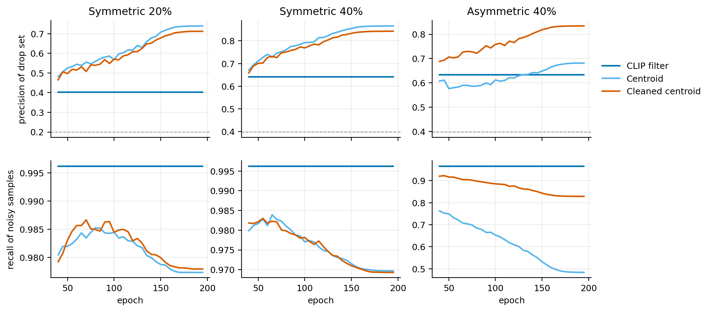

# Noise-Aware Dynamic Data Pruning

**Prithvi Kurmi**  
Department of Computer Science, Georgia State University  
Atlanta, Georgia, USA

An empirical study of label-noise filtering inside InfoBatch using CIFAR-100 and ResNet-18. The project reproduces InfoBatch on clean CIFAR-10/100, evaluates noise-detection signals, and tests a filter based on iteratively cleaned class centroids.

## Main results

All noisy-label runs use ResNet-18, 200 epochs, and synthetic label corruption. Accuracy is final test accuracy in percent. Values with error bars give the mean and sample standard deviation across three training seeds. Other values use one seed. The corrupted dataset is fixed across training seeds.

| Method | Symmetric 20% | Symmetric 40% | Asymmetric 40% |
| --- | --- | --- | --- |
| Full training | 65.55 | 48.00 | Pending |
| InfoBatch | 65.57 | 49.68 ± 0.25 | 47.65 |
| Plain-centroid filter + InfoBatch | 74.61 | 70.03 ± 0.24 | 56.90 |
| Cleaned-centroid filter + InfoBatch | 74.11 | 69.49 ± 0.18 | 69.17 ± 0.27 |

With 40% symmetric noise, cleaned-centroid filtering improves accuracy by 19.81 percentage points over InfoBatch across three matched training seeds. With asymmetric noise, cleaning improves the seed-0 centroid comparison by 12.27 points. Plain centroids remain slightly better under symmetric noise.



The [technical report](report.pdf) describes the method, baseline adaptations, timing boundaries, and limitations. [Generated result tables](outputs/report/results.md) include the remaining baselines and signal diagnostics.

## Included experiment artifacts

The repository includes the historical training logs, JSON summaries, diagnostic AUROC tables, generated figures, and PDF report. These files support rebuilding the tables and figures from the recorded experiments.

Training commands regenerate the large per-example signal tensors and CLIP similarity cache. The `.gitignore` keeps those caches and fresh experimental outputs out of future commits.

## Setup

Use Python 3.12 and a CUDA GPU for the full training suite. The data loader keeps the dataset on the selected device. On a machine without CUDA the scripts use CPU, which is suitable for development checks and is slow for the full suite.

```bash
python3.12 -m venv .venv
source .venv/bin/activate
python -m pip install -r requirements.txt
```

The pinned direct dependencies specify the current CPU-tested environment. The original runs' dependency versions and dataset revisions were unrecorded. PyTorch and torchvision are a matching release pair. A CUDA-specific install can follow the official installation instructions. [PyTorch installation](https://pytorch.org/get-started/previous-versions/)

The first training invocation downloads CIFAR from Hugging Face. CLIP-based runs also download the OpenAI ViT-B/32 weights. Plot generation from the included outputs requires neither download.

## Reproduce the headline comparison

Run these commands from the project root. The default output directory is `outputs/`. Use a separate directory for fresh measurements.

```bash
export INFOBATCH_OUTPUT_DIR="$PWD/outputs_fresh"
python experiments/feature_filters.py --noise sym --eta 0.4 --runs ib ib_cen_iter --seed 0
python experiments/feature_filters.py --noise sym --eta 0.4 --runs ib ib_cen_iter --seed 1
python experiments/feature_filters.py --noise sym --eta 0.4 --runs ib ib_cen_iter --seed 2
```

For the asymmetric-noise comparison, run the following command for training seeds 0, 1, and 2.

```bash
python experiments/feature_filters.py --noise asym --eta 0.4 --runs ib_centroid ib_cen_iter --seed 0
```

`--f0 40` and `--fe 5` are the default filter start and refresh interval. Training seeds vary initialization, sampling, and augmentation. The corruption mask and noisy labels use seed 0 in all runs.

The [Colab notebook](run_all.ipynb) includes setup from an uploaded source archive, persistent Drive output, the headline runs, comparison methods, diagnostics, and figure generation. It also includes an optional missing asymmetric full-training baseline. The complete suite takes substantially longer than a single run.

## Regenerate tables, figures, and PDF

Select the included outputs in a new shell, or point the environment variable to fresh results.

```bash
unset INFOBATCH_OUTPUT_DIR
python make_report.py
python make_figures.py
pdflatex -interaction=nonstopmode -halt-on-error report.tex
pdflatex -interaction=nonstopmode -halt-on-error report.tex
```

The PDF build needs a TeX installation with the packages listed in `report.tex`. Tectonic can also build it with `tectonic report.tex`. The LaTeX source uses the included `outputs/report/pdf_figs/` directory and a manually maintained narrative and main table. Rebuilding plots from fresh experiments requires checking those report values before compiling. Diagnostic figures accept both the original output folders and the historical `_v2` folders.

## Implementation and saved results

- `utils/data.py` loads images and implements augmentation and label corruption.
- `experiments/feature_filters.py` contains the selection methods and training loop. Plain centroids use `cen_iter(..., it=0)`. Cleaned centroids use four centroid updates, a zero disagreement-margin threshold, and refreshes that allow examples to return.
- `experiments/uncertainty_signals.py` measures noisy-label detection AUROC during training.
- `infobatch_repro/repro.py` reproduces InfoBatch on clean CIFAR-10/100.
- `utils/results.py` manages output locations, complete-run checks, atomic writes, and locked summary updates.

Output names distinguish changed filter intervals, reference sizes, alignment windows, epoch budgets, and selection fractions. Matching log and summary records are required before a training run is skipped. Defaults retain the historical filenames. The `.pt` outputs store epoch metrics and filter traces, so an interrupted run restarts from epoch 0. Concurrent writers serialize their result-file and summary commits.

The included `.pt` logs and JSON/CSV summaries are the evidence for the historical results. Current code removes an unused kNN computation from plain-centroid filtering. The reported historical filter timings retain that overhead. CLIP similarities are quantized to the same precision on both first use and cache load, making the current cache paths consistent. The precision behavior of the first historical CLIP cache-generation run cannot be recovered from the saved logs.

## Measurement boundaries and limitations

- `saved_fwd` is the percentage reduction in training examples processed relative to the configured full-training epoch budget on the eligible pool. It excludes filter-refresh passes and CLIP preparation.
- `train_s + filter_s` measures the recorded training and online filtering stages. It excludes evaluation, data loading, and other work outside those timed regions. For symmetric 40% noise, cleaned centroids average 657.0 seconds across three seeds, compared with 1,405.0 seconds for the single full-training run.
- Historical CLIP setup time was unrecorded. Current runs record setup time and whether cached embeddings were used. This setup cost is shared across requested CLIP methods and should be counted once when measuring an entire invocation.
- AlignPrune alone holds out 1,000 clean reference images and trains on 49,000 images. Other historical methods use 50,000 images. Each method's sample-reduction denominator uses its own eligible pool.
- The oracle uses the known corruption mask and provides a privileged-label empirical reference.
- The Yang-style method is an adaptation using frozen CLIP, shared augmentation, and top-35% selection. AlignPrune is a port into this project's recipe. Conclusions apply to these implementations and settings.
- Evidence currently covers one noisy-label dataset, one architecture, one corruption seed, and synthetic noise. The asymmetric full-training baseline, filtering-only ablation, human label noise, and compute-matched comparisons remain pending.
- The current pinned environment has been verified with CPU regression checks; a fresh full-GPU rerun is pending.

## Regression checks

```bash
python -m unittest discover -s tests -v
```

The checks cover equivalent centroid decisions, skipped kNN work, experiment cache identity and recovery, concurrent summary updates, and the local training entry point with a small synthetic dataset. They use no dataset downloads.

## References

- Qin et al., *InfoBatch*, ICLR 2024. [Paper](https://proceedings.iclr.cc/paper_files/paper/2024/hash/ad1d7a4df30a9c0c46b387815a774a84-Abstract-Conference.html)
- Yang et al., *When Dynamic Data Selection Meets Data Augmentation*, ICML 2025. [Paper](https://proceedings.mlr.press/v267/yang25as.html)
- Qin et al., *Beyond Loss Values*, CVPR 2026 Findings. [Paper](https://arxiv.org/abs/2604.07306) · [Code](https://github.com/leonqin430/AlignPrune)
- Kim et al., *FINE Samples for Learning with Noisy Labels*, NeurIPS 2021. FINE uses eigenspace alignment. [Paper](https://arxiv.org/abs/2102.11628)
