# Results

Accuracy is in percent. Error bars use sample standard deviation across training seeds. Synthetic label corruption is fixed at seed 0. Best accuracy is descriptive only.

Training examples saved measures the reduction in training examples processed. Filter refreshes, evaluation, data loading, and external-model preparation are outside this count. Train + filter time includes the two recorded stages. Archived CLIP setup times are unrecorded. Archived plain-centroid timings include an unused kNN calculation removed from the current code. AlignPrune uses a 49,000-image training pool, and other archived methods use 50,000.

Baselines use this project's training recipe. Yang-style selection is an adaptation, and AlignPrune is a port. The oracle is a privileged-label reference. The asymmetric full-training baseline is pending.

## InfoBatch reproduction (ResNet-18)

| Run | Dataset | max lr | Paper | Final | Best | Training examples saved % | Train s |
|---|---|---|---|---|---|---|---|
| c10_full | cifar10 | 0.2 | 95.6 | 95.45 | 95.56 | 0.0 | 1409 |
| c10_ib | cifar10 | 0.2 | 95.5 | 95.35 | 95.35 | 36.4 | 892 |
| c100_full | cifar100 | 0.03 | 78.2 | 77.36 | 77.44 | 0.0 | 1446 |
| c100_ib | cifar100 | 0.05 | 78.2 | 77.56 | 77.76 | 33.4 | 980 |
| c100_full_lr05 | cifar100 | 0.05 |  | 78.69 | 78.75 | 0.0 | 1476 |

## Feature filters, CIFAR-100 asym40

| Method | Seeds | Final acc | Best acc | Training examples saved % | Train + filter s | Filter s | CLIP setup s | Drop / prec / rec (seed 0 end) |
|---|---|---|---|---|---|---|---|---|
| ib | 1 | 47.65 | 47.79 | 30.6 | 990.1 | 0.0 | - |  |
| ib_oracle_f40 | 1 | 74.07 | 74.36 | 54.0 | 658.9 | 0.0 | - | 0.397 / 1.000 / 1.000 |
| ib_clip_f40 | 3 | 67.19 ± 0.17 | 67.34 ± 0.19 | 65.1 | 493.7 | 0.0 | unrecorded | 0.605 / 0.634 / 0.966 |
| yang_k35 | 1 | 43.19 | 58.69 | 56.9 | 740.0 | 117.4 | unrecorded | 0.000 / undefined / 0.000 |
| yang_sel_k35 | 1 | 57.70 | 58.69 | 65.0 | 622.7 | 113.5 | unrecorded | 0.650 / 0.471 / 0.771 |
| ib_align | 1 | 47.42 | 47.62 | 21.1 | 1130.3 | 8.9 | - | 0.513 / 0.404 / 0.522 |
| ib_centroid_f40 | 1 | 56.90 | 56.97 | 53.2 | 761.2 | 90.1 | - | 0.282 / 0.681 / 0.483 |
| ib_cen_iter_f40 | 3 | 69.17 ± 0.27 | 69.38 ± 0.26 | 57.1 | 676.5 | 73.8 | - | 0.395 / 0.834 / 0.828 |

CLIP closes 74% of the InfoBatch to oracle gap.  
AlignPrune closes -1% of the InfoBatch to oracle gap.  
Centroid closes 35% of the InfoBatch to oracle gap.  
Cleaned centroid closes 81% of the InfoBatch to oracle gap.  

## Feature filters, CIFAR-100 sym20

| Method | Seeds | Final acc | Best acc | Training examples saved % | Train + filter s | Filter s | CLIP setup s | Drop / prec / rec (seed 0 end) |
|---|---|---|---|---|---|---|---|---|
| full | 1 | 65.55 | 65.63 | 0.0 | 1426.1 | 0.0 | - |  |
| ib | 1 | 65.57 | 65.73 | 31.3 | 1004.4 | 0.0 | - |  |
| ib_oracle_f40 | 1 | 75.74 | 75.88 | 43.3 | 826.8 | 0.0 | - | 0.199 / 1.000 / 1.000 |
| ib_clip_f40 | 1 | 68.84 | 68.94 | 59.2 | 591.0 | 0.0 | unrecorded | 0.494 / 0.402 / 0.996 |
| yang_k35 | 1 | 61.64 | 69.40 | 56.9 | 737.5 | 117.3 | unrecorded | 0.000 / undefined / 0.000 |
| yang_sel_k35 | 1 | 70.26 | 70.34 | 65.0 | 628.5 | 113.7 | unrecorded | 0.650 / 0.262 / 0.855 |
| ib_align | 1 | 65.93 | 65.96 | 20.7 | 1137.5 | 8.9 | - | 0.474 / 0.190 / 0.453 |
| ib_centroid_f40 | 1 | 74.61 | 74.76 | 50.0 | 814.5 | 90.3 | - | 0.263 / 0.740 / 0.977 |
| ib_cen_iter_f40 | 1 | 74.11 | 74.42 | 50.7 | 764.5 | 73.8 | - | 0.274 / 0.712 / 0.978 |

CLIP closes 32% of the InfoBatch to oracle gap.  
AlignPrune closes 4% of the InfoBatch to oracle gap.  
Centroid closes 89% of the InfoBatch to oracle gap.  
Cleaned centroid closes 84% of the InfoBatch to oracle gap.  

## Feature filters, CIFAR-100 sym40

| Method | Seeds | Final acc | Best acc | Training examples saved % | Train + filter s | Filter s | CLIP setup s | Drop / prec / rec (seed 0 end) |
|---|---|---|---|---|---|---|---|---|
| full | 1 | 48.00 | 48.97 | 0.0 | 1405.0 | 0.0 | - |  |
| ib | 3 | 49.68 ± 0.25 | 49.98 ± 0.26 | 28.8 | 1013.9 | 0.0 | - |  |
| ib_oracle_f40 | 1 | 71.60 | 71.63 | 52.8 | 667.2 | 0.0 | - | 0.397 / 1.000 / 1.000 |
| ib_clip_f40 | 1 | 65.20 | 65.55 | 64.7 | 511.3 | 0.0 | unrecorded | 0.618 / 0.641 / 0.996 |
| yang_k35 | 1 | 45.26 | 63.39 | 56.9 | 737.8 | 118.1 | unrecorded | 0.000 / undefined / 0.000 |
| yang_sel_k35 | 1 | 63.43 | 63.94 | 65.0 | 624.1 | 113.5 | unrecorded | 0.650 / 0.517 / 0.845 |
| ib_align | 1 | 48.31 | 49.58 | 21.1 | 1134.7 | 8.9 | - | 0.514 / 0.391 / 0.506 |
| ib_centroid_f10 | 1 | 67.01 | 67.05 | 71.2 | 519.1 | 107.5 | - | 0.486 / 0.800 / 0.978 |
| ib_centroid_f40 | 3 | 70.03 ± 0.24 | 70.22 ± 0.20 | 57.8 | 692.4 | 90.4 | - | 0.445 / 0.866 / 0.970 |
| ib_cen_iter_f40 | 3 | 69.49 ± 0.18 | 69.55 ± 0.10 | 58.5 | 657.0 | 73.8 | - | 0.457 / 0.842 / 0.969 |
| ib_knn_f10 | 1 | 24.44 | 29.07 | 93.1 | 209.3 | 108.2 | - | 0.937 / 0.424 / 1.000 |
| ib_knn_f40 | 1 | 63.98 | 64.07 | 68.4 | 543.0 | 90.5 | - | 0.645 / 0.614 / 0.997 |

CLIP closes 71% of the InfoBatch to oracle gap.  
AlignPrune closes -6% of the InfoBatch to oracle gap.  
Centroid closes 93% of the InfoBatch to oracle gap.  
Cleaned centroid closes 90% of the InfoBatch to oracle gap.  

## Mean AUROC, epochs >= 40, asym40_ib_s0

| Signal | All | High-loss half |
|---|---|---|
| loss | 0.552 | 0.516 |
| MSP | 0.527 | 0.476 |
| energy | 0.505 | 0.462 |
| margin | 0.565 | 0.552 |
| knn | 0.613 | 0.575 |
| centroid | 0.706 | 0.688 |
| knn_dist | 0.516 | 0.484 |

## Mean AUROC, epochs >= 40, asym40_ib_s0_v2

| Signal | All | High-loss half |
|---|---|---|
| loss | 0.552 | 0.516 |
| MSP | 0.527 | 0.476 |
| energy | 0.505 | 0.462 |
| margin | 0.565 | 0.552 |
| knn | 0.613 | 0.575 |
| centroid | 0.706 | 0.688 |
| knn_dist | 0.516 | 0.484 |
| cen_norm | 0.678 | 0.647 |
| cen_iter | 0.809 | 0.801 |
| cen_iter_norm | 0.785 | 0.760 |

## Mean AUROC, epochs >= 40, sym20_ib_s0

| Signal | All | High-loss half |
|---|---|---|
| loss | 0.675 | 0.633 |
| MSP | 0.615 | 0.518 |
| energy | 0.574 | 0.461 |
| margin | 0.674 | 0.626 |
| knn | 0.816 | 0.821 |
| centroid | 0.848 | 0.848 |
| knn_dist | 0.742 | 0.688 |

## Mean AUROC, epochs >= 40, sym20_ib_s0_v2

| Signal | All | High-loss half |
|---|---|---|
| loss | 0.675 | 0.633 |
| MSP | 0.615 | 0.518 |
| energy | 0.574 | 0.461 |
| margin | 0.674 | 0.626 |
| knn | 0.816 | 0.820 |
| centroid | 0.848 | 0.848 |
| knn_dist | 0.742 | 0.688 |
| cen_norm | 0.782 | 0.787 |
| cen_iter | 0.849 | 0.848 |
| cen_iter_norm | 0.784 | 0.786 |

## Mean AUROC, epochs >= 40, sym40_ib_s0

| Signal | All | High-loss half |
|---|---|---|
| loss | 0.659 | 0.599 |
| MSP | 0.604 | 0.493 |
| energy | 0.576 | 0.468 |
| margin | 0.654 | 0.580 |
| knn | 0.808 | 0.793 |
| centroid | 0.797 | 0.794 |
| knn_dist | 0.674 | 0.614 |

## Figures

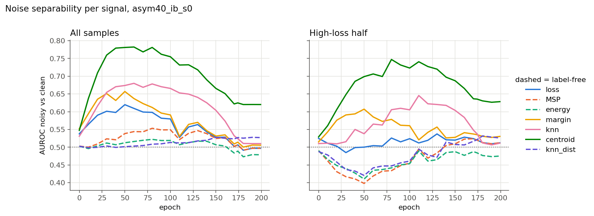
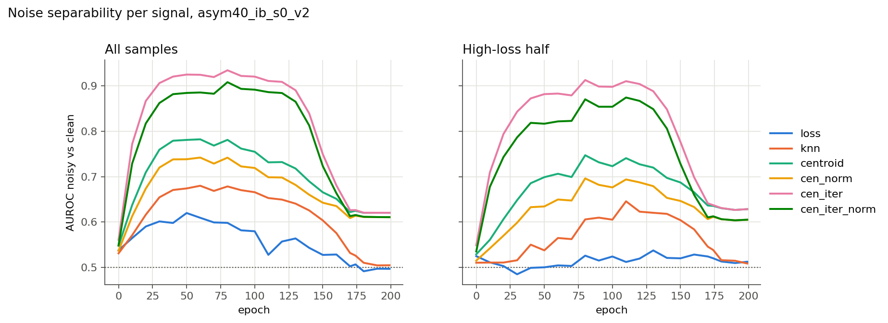
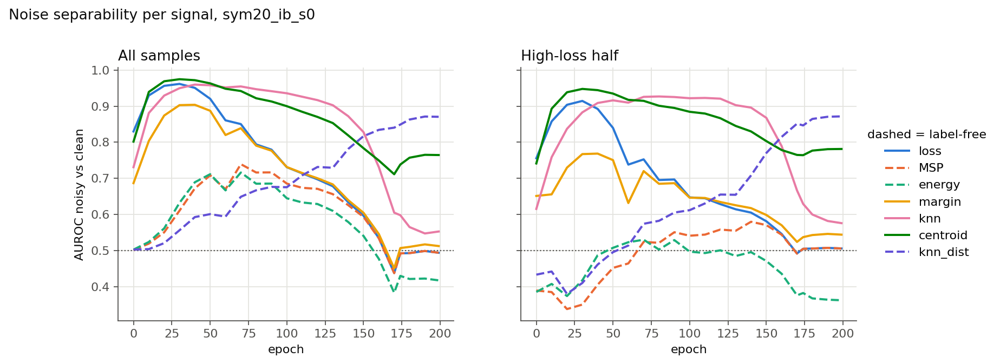
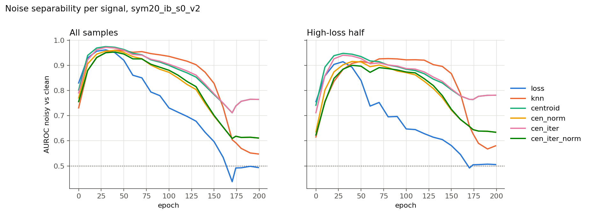
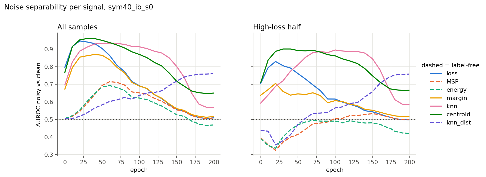
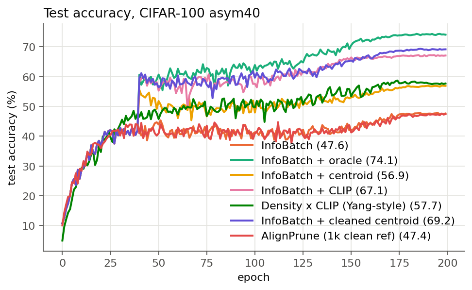
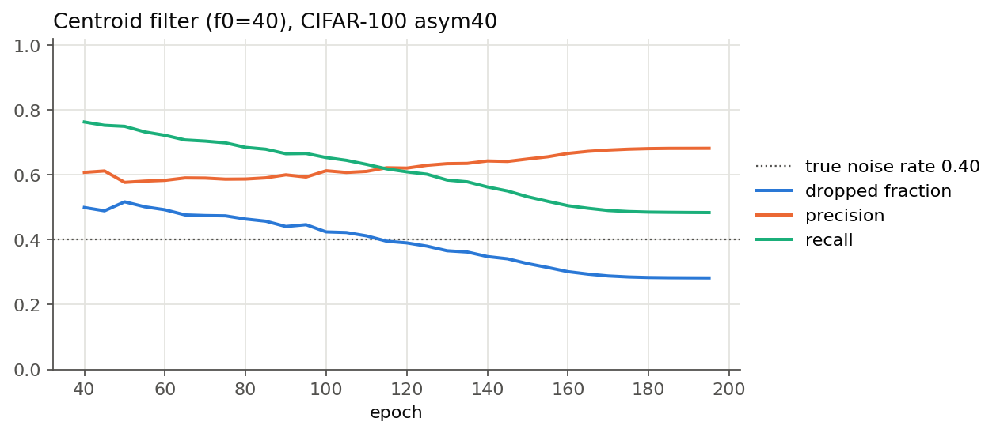
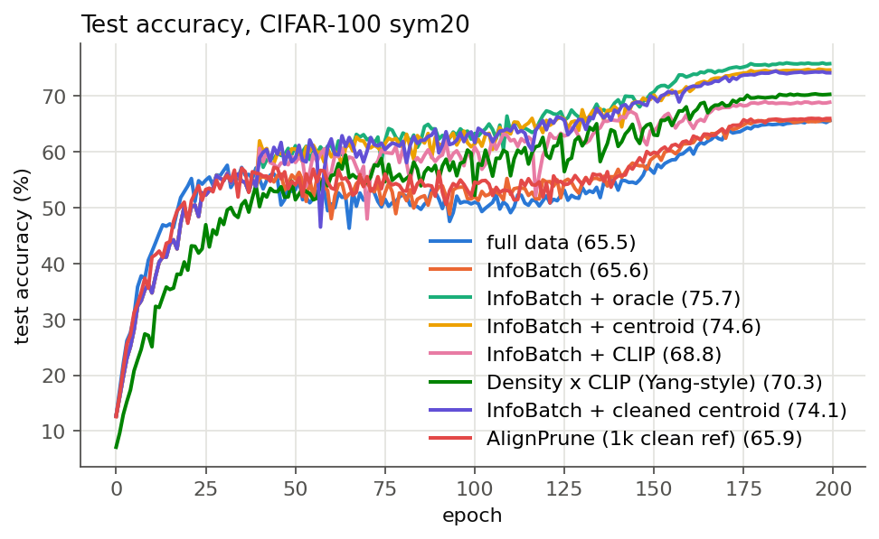
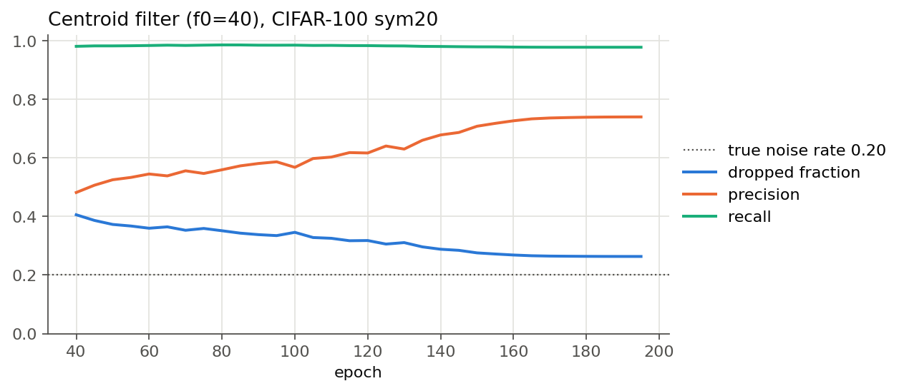
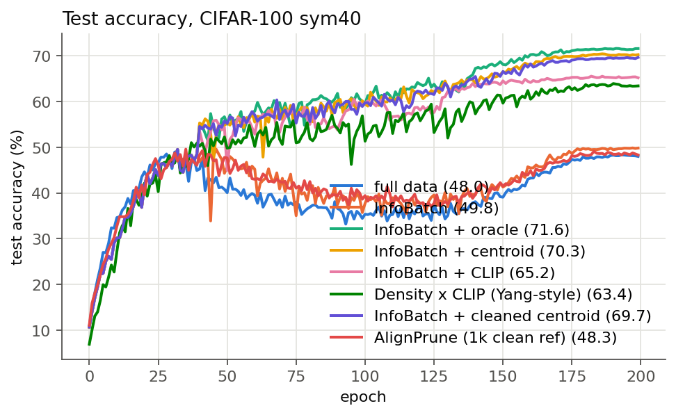
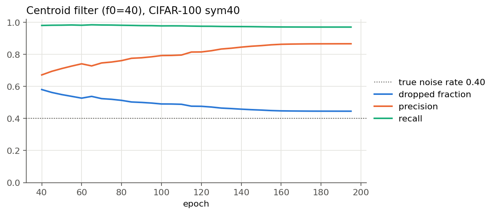
